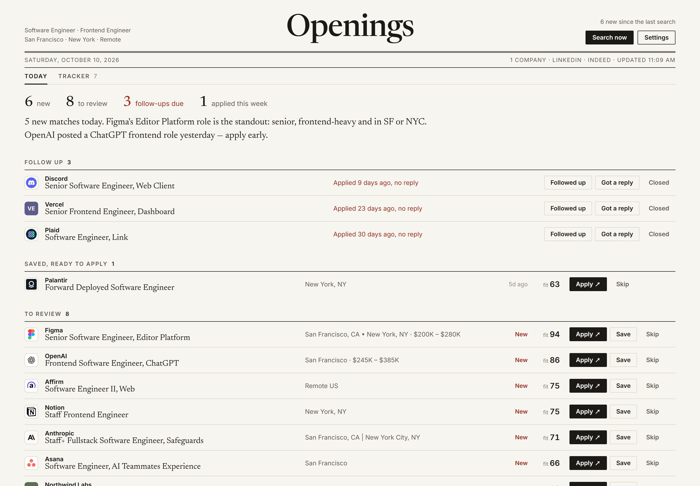
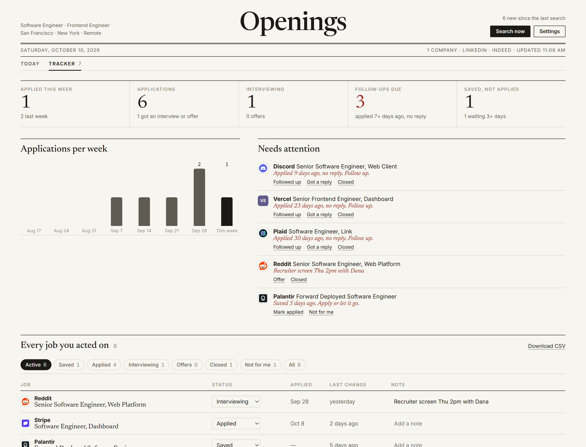

# job-newtab

**A new tab that job-hunts for you.** Every day an agent checks company career boards and your LinkedIn / Indeed searches, scores each new opening against your resume, and gives you one list to work through: best fit first, one line per job, with **Apply**, **Save** and **Skip** on every row. Open a new tab, apply to a few, close it. Your applications are tracked as you go.

<picture>
  <source media="(prefers-color-scheme: dark)" srcset="docs/front-page-dark.png">
  
</picture>

<sub>Screenshots use demo data.</sub>

- **You choose the sources.** Pick target roles, levels, US metros or remote, LinkedIn / Indeed, and any of 46 preset companies, or paste any Greenhouse, Lever or Ashby careers link.
- **Public APIs first.** Company boards are read through their public Greenhouse / Lever / Ashby JSON APIs, so there is no scraping and the cost stays low. LinkedIn and Indeed searches open in a background window with your own sign-in.
- **A daily queue, not a feed.** Each job gets a 0–100 fit score from role (40), skills from your resume (35), location (15) and freshness (10); a job that breaks one of your rules is capped at 29 and says which rule. Click a row for the agent's take, the reasons it fits, what to check (level, sponsorship, on-site, your "no crypto" rule) and the score's parts. **Apply** opens the posting and, when you come back, asks whether you applied. **Skip** clears the row and tells the agent what you don't want. The day is done when the list is empty.
- **Only what's new to you.** Career-board jobs it has already shown you are not sent to the agent again, and anything found since the last search is marked New. The same opening found on LinkedIn and on the company's board appears once, with the direct link.
- **A tracker built in.** Save jobs, then move them through Applied → Interviewing → Offer / Closed. The Tracker view shows applications per week, follow-ups due (a week with no reply), jobs saved but not applied, and every job you acted on with notes; export it as CSV. The agent reads the same pipeline before each search, so it never re-lists what you applied to and ranks openings like the ones you skipped lower. Follow-ups due show at the top of Today too, with **Followed up** to reset the clock.
- **Backups.** Removing an extension deletes its data, so Settings has **Download backup** / **Restore from file**: one JSON file with your profile, settings, jobs and tracker (never the API key). The API-key screen offers the restore too, for reinstalls.
- **No server.** The extension runs the agent with your own Anthropic API key. Everything else stays in your browser.

<picture>
  <source media="(prefers-color-scheme: dark)" srcset="docs/tracker-dark.png">
  
</picture>

> Early and experimental. US job market only for now. Runs with your own Anthropic API key.

## Install

You need Chrome (or another Chromium browser) and an [Anthropic API key](https://platform.claude.com/).

**From a release (no build tools needed)**

1. Download `job-newtab-<version>-chrome.zip` from the [latest release](../../releases/latest) and unzip it.
2. Open `chrome://extensions`, turn on **Developer mode**, click **Load unpacked** and pick the unzipped folder.

**From source** (Node.js 20+)

```bash
git clone https://github.com/Syair/job-newtab.git && cd job-newtab
npx pnpm@10.11.1 install
npx pnpm@10.11.1 build
```

Then load `apps/extension/.output/chrome-mv3` with **Load unpacked** as above.

Open a new tab, paste your key, set up your search, and click **Find my jobs**. The first search takes a few minutes; you can close the tab while it runs. To update, unzip the new version over the old folder and click the reload icon on `chrome://extensions`; your data stays. Don't click **Remove**: removing an extension deletes its data. If you do need to remove it, download a backup from Settings first.

## How a search works

1. **Career boards.** The extension fetches each selected company's public job board and keeps the openings whose title, level and location fit your profile, skipping any it has shown you before (up to 120 per search, spread fairly across companies).
2. **Job boards.** It builds LinkedIn / Indeed search URLs from your profile (roles × places, filtered to postings since the last search) and opens up to 6 of them in a background window. Later searches rotate through the rest. Result pages only show cards, so it then reads the full description of up to 20 of the most relevant new jobs (titles that match your roles): LinkedIn postings from LinkedIn's public job page, fetched without your cookies, and Indeed postings in the background window.
3. **Scoring and editing.** A Claude Managed Agents session reads both, scores every opening against your resume and preferences, and writes a `jobs.json`: a short summary and the scored jobs, each with a one-sentence take for you.
4. **Your tab.** The extension checks that file and merges it with what you have already seen. Then it shows the new matches first.

Searches repeat automatically (daily by default; 6/12/24/48 h in Settings) once you have run the first one by hand. If no tab is open, a notification tells you when new matches arrive.

## Privacy

- Sent to the Anthropic API for each search: your profile (roles, places, preferences, **resume text**), the matching career-board listings, the sanitized HTML of up to 6 LinkedIn / Indeed result pages, and the description text of up to 20 job pages. The agent session and every uploaded file are deleted when the search ends.
- The extension only has access to linkedin.com, indeed.com, the three ATS APIs and api.anthropic.com. It does not read your browsing history.
- Company logos load from Google's favicon service (`www.google.com/s2/favicons`), which sees the company domains shown on your page and nothing else. Unknown companies get a monogram instead.
- Your API key, profile and jobs are stored in `chrome.storage.local`. Anyone with access to your browser profile can read them. Do not publish this to a store as-is.
- The data survives disabling the extension, restarting Chrome and updates; only removing the extension deletes it. Backup files contain your resume and tracker in plain JSON: keep them somewhere private.
- Each search sends the agent your pipeline (titles and companies you saved, applied to or marked "Not for me").
- Scraping LinkedIn or Indeed, even through your own signed-in browser, may conflict with their terms of service. Turn them off in Settings to use public career-board APIs only.

## Cost

Each search is one agent session billed to your key. Claude Sonnet 5.5 is the default; Claude Haiku 5.5 is much cheaper and fine for scoring; Claude Opus 5.5 is the most thorough. Fewer companies and board searches mean less to read.

## Development

```bash
pnpm dev          # WXT with hot reload
pnpm typecheck    # all packages
pnpm test         # unit tests (no network, no API calls)
pnpm ats:smoke    # hit the real Greenhouse/Lever/Ashby APIs for every preset company (free)
pnpm agent:run    # one real end-to-end search via the API (needs ANTHROPIC_API_KEY in .env; costs credits)
node harness/preview/serve.mjs   # after `pnpm build`: preview the new-tab UI with mock data at localhost:5180/?state=board
```

| Path | What |
|---|---|
| `packages/agent-core` | Host-agnostic core: profile, ATS clients, filters, search-URL builder, jobs.json validation and merging, the agent loop |
| `apps/extension` | The MV3 extension (WXT + React): service-worker build host, scraper, new-tab UI |
| `harness` | Node scripts: ATS smoke test, real end-to-end run, UI preview with mock `chrome.*` |

See [ARCHITECTURE.md](ARCHITECTURE.md) for how the pieces fit.

## Credits

The agent engine (service-worker build host, Managed Agents session loop with lossless reattach, background-window scraper) started from [ThariqS/ai-newtab](https://github.com/ThariqS/ai-newtab), MIT-licensed. job-newtab replaces its history-driven, model-written homepage with profile-driven job sources, a fixed UI and structured, validated output.

## License

MIT — see [LICENSE](LICENSE).
